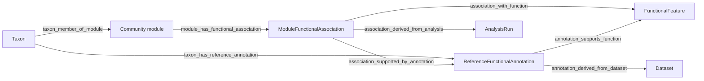

# Functional annotation paths and reasoning plan — 2026-10-09

Status: researched implementation plan; the additions below are proposed, not implemented. Existing projections and live endpoints were inspected on 2026-10-09. Preserve the earlier enrichment snapshots and dated documentation.

## Verified starting point

Constellations on port **10291** serves `mvp_functional_20261008`. Its primary enrichment snapshot is `catalog_unweighted_20261008`; four qualified module–function associations are present. Primary enrichment remains unweighted, with empirical permutation Z/p and BH q. Abundance profiles and structural centrality remain separate; weighted KS/ranked affinity remains next-version work.

Existing evidence structure:



`scripts/ngraph_functional_kg.py` already projects the association statistics and native carrier evidence, validates frozen catalog artifact hashes, and preserves unknown original annotation provenance. It retains one active functional projection per output branch; complete historical analysis artifacts remain separately scoped. It does not retain all historical projections together in the active graph.

`scripts/ngraph_kg_connectivity.py` already offers `module_function` and `taxon_function`. The requested combined `Taxon → Module → Association → Function` preset is missing. The service exposes `/api/kg/metapaths` and `/api/kg/connectivity`; the frontend separately hard-codes the preset descriptions. The path-detail field whitelist currently omits permutation Z, null moments and evidence scope, even though Z exists on the association node. The connectivity endpoint has no explicit threshold/method/model/snapshot filter parameters. The query/RAG layer has no typed functional-path executor.

Verified example: community M3 has **206** members; **110** support the projected KEGG M00091 PE-to-PC biosynthesis framework. The association q is approximately **0.00375**, Z approximately **4.437**. `taxon:S__3300004630_4` is a supporting member; `taxon:S__3300000322_5` is a member without this projected supporting annotation. A missing projected annotation is not a claim of biological absence. Projection currently includes only carrier evidence supporting qualified associations; the full reference inventory remains outside the graph.

Current IDs for reproducible example checks:

- Community module: `module:mvp_functional_20261008:prev_10:pearson:vgae:M3`
- Function node: `function:28567facea19315122fd9b3e`
- Association: `functionalassociation:f3a24c18ca2eab83e3698451`

## Scientific meaning and reasoning boundary

Two questions need different answers:

1. **Module context:** is taxon T assigned to a community module enriched for function X?
2. **Carrier evidence:** does T's mapped reference have recorded support for X, and is that annotation a supporting witness for this same module association?

The first must never automatically imply the second. Neither establishes expression, measured ancient metabolic activity, causal ecological influence, or a functional role merely from high network centrality. Unknown original database/tool release remains unknown. Native reference identifiers must not be promoted to verified species/NCBI taxon identities without a reviewed mapping.

Keep community-module labels such as `VGAE M3` distinct from KEGG functional modules such as `M00091`. KEGG modules are definitions over KO sets, including AND, OR and optional elements; flattening those definitions into plain membership edges loses their meaning. Preserve the evaluated expression, essential-step policy and definition hash. [KEGG MODULE documentation](https://www.kegg.jp/kegg/module.html).

Default graph views should continue to show qualified unweighted associations. An optional all-tests view can retrieve the full analysis table with explicit significance/publication status; do not turn every tested result into a positive functional assertion. No qualified association for a module means no published result under this analysis policy, not no function.

## Recommended representation

Retain the existing association node as the authoritative statistical assertion. Store its subject module, object function and full evidence rather than making an unsupported `taxon performs function` edge. This follows the evidence-bearing association pattern in the [Biolink Association model](https://biolink.github.io/biolink-model/Association/). Our community module is a project-specific class; do not force it into a gene/gene-product association class or claim existing Biolink compliance.

For each association require: output branch/discovery run, threshold, network method, assignment system, annotation snapshot, test family/background hash, unweighted/weighted method, empirical Z and null moments, p/BH q, effect sizes, independent-reference counts, coverage, exchangeability, Monte Carlo diagnostics, publication-policy version, source artifact hashes and biological review status. Statistical evidence and annotation reliability are separate dimensions. Z, q and DWPC are not posterior probabilities.

Introduce stable function **concepts** (`kegg.module:M00091`, `kegg.orthology:K00003`) and separate versioned definition records. Retain current hashed IDs and explicit links to the concepts; do not destructively rename historical nodes or assert that differing definition versions are identical. The registered namespaces are documented by [Bioregistry KEGG Module](https://www.bioregistry.io/registry/kegg.module) and [KEGG Orthology](https://www.bioregistry.io/registry/kegg.orthology).

Scope community modules by discovery run/threshold/method/model; `M3` in two runs is not automatically the same biological community. Preserve context even when a canonical function concept is shared. Reference annotations need reference identity, native gene/KO evidence, source-row identifiers and annotation snapshot. Add explicit ReferenceGenome entities when extending this layer, rather than implying every gene belongs to every taxon mapped to a reference. Native gene IDs require reference/provider scoping.

Map results/datasets to provenance entities and analysis executions to provenance activities; use generation versus derivation according to their meaning. The existing relation names can stay compatible while an RDF export supplies reviewed PROV mappings. [PROV-O](https://www.w3.org/TR/prov-o/) provides the entity/activity and qualified provenance patterns.

An optional visual shortcut `Module → Function` may collapse the association node for readability, but it must retain the association ID and expand to the full evidence chain. It must not create another independent piece of evidence or duplicate the path count.

## Ordered implementation

### 1. Deliver the requested paths with the existing graph

- Add `taxon_module_function`: `taxon_member_of_module` → `module_has_functional_association` → `association_with_function`.
- Add a supporting-carrier mode that joins this path to `association_supported_by_annotation` and `taxon_has_reference_annotation` for the **same taxon, same association, same function and same analysis scope**. This is a constrained witness join, not an unconstrained extra hop through any carrier.
- Support reverse questions: which modules are associated with function X; which of their members have supporting evidence? Add core/sample restrictions through observed taxon evidence, with the observation policy explicit. Abundance/context is not evidence of measured function.
- Require branch/run, threshold, network, module system and snapshot in the query contract. Validate source/target types and ordered predicates. Select graph incidence and degrees under the same filter scope before calculating descriptive DWPC.
- Return membership context separately from carrier status: `supported_in_catalog`, `no_complete_support_recorded`, `unmapped`, `not_evaluated`, or `outside_projected_inventory`. Distinguish these using frozen inventory/background tables, not merely a missing graph edge.
- Include Z, null mean/SD, effect, q, scope, independent counts, annotation confidence and source links in path detail. Preserve exact/lower-bound count and pagination semantics. Deduplicate witnesses by independent reference for evidence summaries.

Primary files: `ngraph_kg_connectivity.py`, `14_ngraph_local_browser.py`, `config_kg_schema.json` and `web_assets/constellations/app.js`. Expose preset labels/type constraints from one shared API catalog to avoid frontend/backend drift. No new database or retraining is needed for this first milestone.

### 2. Make the interface show meaning and evidence

- Add a saved **Taxon → community module → function** demonstration using M3/M00091.
- Add “Show module function paths” from taxon/module selections and “Open association in KG” from Functions results.
- Keep the graph prominent; display a readable community-module label and function name/identifier. Allow expanded and collapsed association views.
- In the right evidence panel show a membership badge separately from carrier support, the analysis statistics, native KO evidence and original-release/review status. Allow filtering to supporting carriers and show missing/unknown statuses honestly.
- Keep rare taxa visible: centrality/abundance may sort a separate contributor table but do not silently weight the primary enrichment. Core/time plots remain relative profiles.

### 3. Harden schema, provenance and publication

- Add canonical concepts/versioned definitions and explicit analysis/background relations incrementally, preserving old IDs and schema compatibility.
- Require exactly one subject community module, one function definition and one generating analysis per assertion; validate compatible scopes and at least five independent supporting references for current qualified links.
- Explicitly validate background inclusion and carrier evidence against the recorded analysis, not just a `publish_kg` flag. Retain all existing q/effect/coverage/exchangeability/uncertainty gates.
- Publish a complete new graph snapshot and atomically switch the active pointer; retain prior projections and their manifests for audit/retraction. The current two-file replacement is not a multi-file transaction.
- Keep a versioned local semantic mapping registry. A later RDF export can express the same checks as SHACL shapes; SHACL is validation, not a statistical or causal inference engine. [SHACL specification](https://www.w3.org/TR/shacl/).

### 4. Add bounded reasoning and grounded Query

First implement deterministic, read-only rules:

- Membership + qualified association → **member of a module associated with X**.
- Same-taxon's annotation + same association's supporting witness → **reference-supported contributor to that association**.
- A verified ontology/category mapping → a clearly labelled broader functional grouping, carrying its mapping provenance. Do not copy child q-values as enrichment tests of the parent category.

Never infer activity, causality, function for all members, biological absence from missing records, or an exact ontology equivalence from a similar name. This missing-is-unknown policy is consistent with [OWL's open-world semantics](https://www.w3.org/TR/owl-primer/raw_overview.html); an OWL reasoner alone does not supply these project-specific statistical rules.

Allow Query to select an approved typed query template and resolve entities, execute the bounded graph query, then synthesize only from the returned evidence bundle. Include node/edge/assertion IDs, rule/version, query scope, source hashes, caveats and explicit unknowns. Derived claims should carry their proof paths. Deterministic rules establish what can be asserted; the language model explains the results.

### 5. Extend only after the path/reasoning acceptance gate

- Add KO-level concepts and source evidence for selected functions, with reusable sparse mappings and explicit completeness logic. Avoid materializing every reference gene merely to answer module questions.
- Curate GO/EC/other mappings with exact-versus-related mapping status. GO explicitly ties gene-product annotations to sources and evidence types; do not fabricate a GO experimental evidence code for legacy inferred support. [GO annotation documentation](https://www.geneontology.org/docs/go-annotations/).
- Add weighted KS/ranked affinity as separate assertions and correction families. Keep unweighted enrichment primary.
- Introduce relation-specific KG learning later, after rule-based and simple graph baselines. For held-out tasks, remove target assertions and their derivation/witness shortcuts before training or scoring; otherwise predicting enrichment links can merely recover the computation that created them. Use independent-core/reference-block evaluations as appropriate to the exact target task.
- Scale incidence/witness lookup with indexed sparse mappings and the existing SQLite annotation inventory, preserving the API contract. Benchmark storage/query alternatives before committing to a graph database. Bound evidence expansion and avoid exhaustive enumeration through high-degree provenance nodes.

Het.io's metapath/DWPC approach provides a useful model for typed connectivity, but our current DWPC is descriptive. Do not reuse enrichment permutation p-values as metapath significance or combine dependent paths as independent studies. [Het.io methodology](https://het.io/hnep/).

## Acceptance gates

1. A fixture has two members in an enriched module and only one supporting reference: both yield the module-context path; only the carrier yields a supporting-witness result. The other receives no inherited function assertion.
2. M3/M00091 reproduces the stored association statistics and native evidence. Unknown release and no-activity interpretation remain visible.
3. A second analysis reusing `M3` and M00091 cannot contaminate the selected scope; canonical function lookup still finds both correctly separated results.
4. Invalid types, incompatible definitions/scopes, altered artifact hashes, missing provenance, duplicated aliases and incomplete support fail validation or return explicit unknown status.
5. Known fixture path counts/degrees are exact; capped enumeration is labelled lower-bound. Expanded/collapsed views do not double-count evidence. Constant-null Z remains undefined.
6. Real Chromium checks cover taxon/module/function selection, both evidence modes, graph interaction, statistics/provenance, pagination, reverse searches and deep links on 10291.
7. Query answers carry executable proof/evidence IDs; adversarial questions cannot promote membership into function/activity, treat absence as negative, or turn centrality into causality.

The first implementation batch should deliver stages 1–2 and their fixtures/browser checks. Stage 3 establishes the versioned foundation, followed by deterministic reasoning and KG-backed Query. HMM niche modelling remains separate future work.


## Implementation checkpoint — 2026-10-09

The bounded integration is implemented for `mvp_functional_20261008`, `prev_10`/Pearson/VGAE, annotation snapshot `catalog_unweighted_20261008`. The original enrichment snapshot and its 954 tests are unchanged. Four qualified associations remain published. The active graph bundle is `knowledge_graph/snapshots/functional-ad4cacf8c1ea6bf29e130b66/`: 38,218 nodes and 364,315 edges, with zero dangling references. `knowledge_graph/active_snapshot.json` selects it atomically. Earlier snapshots and base TSV artifacts are retained.

### Delivered behavior

- Combined taxon→community module→association→function, reverse function→modules/members, and existing direct reference-support paths are available. Canonical `kegg.module:M00091`, plain `M00091`, scoped feature IDs and module IDs resolve within the chosen analysis. Branch, prevalence threshold, network, assignment system and annotation snapshot define the scope; optional core/library context restricts membership through recorded TAD/read observations. This context is not measured function.
- **All module members** and **Supporting carriers only** are distinct modes. Carrier mode joins the same taxon's native annotation to the same association and function. Independent witnesses are deduplicated by reference identity; their number does not inflate the community path count. Counts and relation-specific degrees use the same filtered graph. Enumeration/evidence caps remain explicit.
- Membership, carrier status, q, permutation Z/null moments, effect, scope, source rows/genes/KOs, annotation reliability and pending biological review are inspectable. The frozen indexed inventory distinguishes no complete recorded support, unmapped/not evaluated records, and evidence outside the small projection. None establishes biological absence.
- A saved M3/M00091 example, taxon/module/function-result deep links, reverse searches and compact/expanded graph views are implemented. Compact views retain the assertion ID and do not duplicate evidence. Detailed provenance scrolls independently to keep the graph page bounded.
- Stable canonical function concepts link to existing versioned feature IDs. Frozen KEGG definition expressions and hashes remain attached to the feature; logical AND/OR/optional semantics are preserved. Explicit ReferenceGenome nodes identify supporting references. No ontology equivalence or new biological classification was inferred.
- Publication validates one subject/module, one definition and one analysis per assertion; compatible scopes; matching native reference identity; at least five independent reference witnesses; frozen definition/artifact hashes; carriers belonging to the scoped independent background; and compatible stored carrier/module counts. Existing statistical gates still apply. Complete bundles, including the support-status index, are written before switching the active pointer. Failed activation leaves the previous complete bundle active.
- Query now recognizes a bounded set of functional questions containing explicit `S__...`, `M3` or KEGG `M00091` identifiers, executes an approved typed search, and returns deterministic claims with node/edge/assertion IDs, proof IDs, `functional-rules-1`, scope, graph snapshot and source hashes. Other questions retain the existing retrieval route. Unresolved names request explicit IDs; no arbitrary graph expression is executed. A general entity resolver, multi-turn interpretation and LLM explanation of graph proofs remain future work.

### Examples and acceptance

On Constellations **10291**, open Knowledge Graph → Metapath search → **Example: taxon to function**. It shows `taxon:S__3300004630_4` → VGAE M3 → association → M00091, with its native reference witness. The member `taxon:S__3300000322_5` has the same module-context path but `no_complete_support_recorded`; carrier-only mode excludes that path. Reverse M00091 search finds **206 module members, 110 supporting carriers**. M3 has 202 independently annotated background references; the broader community member count is a different denominator.

Example Query: `Which functions are associated with S__3300000322_5 and M00091?` The answer states module context and the recorded support limitation, with an inspectable proof link. It does not assert activity or assign function from membership. Canonical concepts do not silently select a definition from another snapshot.

Verification: **72 functional tests plus four catalog/statistics tests**, 11 focused Chromium path/Query/deep-link checks, and 12 wider interface checks pass. Fixtures cover member-only versus carrier, cross-scope exclusion, duplicate-reference independence, incompatible definitions, missing ownership/provenance, invalid endpoint types and interrupted activation. The full KG validator reconstructs source-derived proxy values, verifies bundle hashes and confirms zero dangling references. Python and JavaScript compile checks and the modified KG importer R parse pass. Automated checks do not replace human or scientific acceptance.

Reports/screenshots: `results/ngraph/mvp_functional_20261008/functional_validation/20261009/`. Logs: `logs/functional_paths_20261009/` and branch-specific projection/validation logs. Runtime versions: Python 3.14.5, pandas 2.3.3, NumPy 2.4.6, SciPy 1.17.1, NetworkX 3.6.1, Cytoscape.js 3.30.2; browser verification uses Node 22.20.0 and Chromium 151.0.7922.77. No new package installation or proteome annotation was required.

Reproduce the projection and validation from the actual checkout:

```bash
PY_NGRAPH=/maps/projects/caeg/people/gfx654/miniforge3/envs/ngraph/bin/python
"$PY_NGRAPH" scripts/ngraph_functional_kg.py --branch mvp_functional_20261008 --threshold prev_10 --method pearson --model vgae --snapshot catalog_unweighted_20261008
"$PY_NGRAPH" scripts/ngraph_validate_kg_substrate.py --branch mvp_functional_20261008
NG_PYTHON="$PY_NGRAPH" NG_BRANCH=mvp_functional_20261008 NG_LOG_SCOPE=functional_paths_20261009 bash start_server.sh 10291
```

The startup command is for an available port; do not start a second listener over the running service. Port 10289 remains archived; loopback 10292 is a development preview.

### Remaining scope

Biological specificity/original-release review, particularly CAM framework labels, is still required. Unweighted enrichment remains primary; abundance/core profiles stay separate. Weighted KS/ranked affinity, HMM niches, reviewed ontology/category mappings, full KG learning and leakage-controlled independent-core evaluations remain subsequent work. The original ordered MVP backlog is retained; its Query item is now partially delivered through explicit-ID functional searches, while general routing and multi-turn context remain open.

## Next implementation plan

The [2026-10-12 functional RAG implementation plan](FUNCTIONAL_RAG_IMPLEMENTATION_PLAN_2026-10-12.md) specifies the next delivery: shared indexed evidence, recorded-name resolution, grounded Gemini explanations, contributors/profiles, conversation context and selected semantic mappings. It extends this completed KG checkpoint without changing enrichment statistics or marking the remaining work complete.
